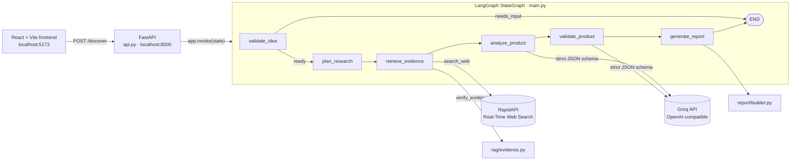

# Product Discovery & Validation Agent

**From a one-line product idea to a structured discovery report — problems, users, competitors, assumptions, an MVP scope and the experiments to test it.**


Most product ideas fail because nobody checked the problem, the users or the competition before building. This project automates the first pass of that homework. You describe an idea; a LangGraph workflow searches the web, filters the results, asks an LLM to analyse only that evidence under a strict JSON schema, and turns the analysis into an MVP and a validation plan. The output is a report that tells you what to test, not a verdict that the idea is good.

## Table of Contents

- [Overview](#overview)
- [The Problem](#the-problem)
- [Key Features](#key-features)
- [How It Works](#how-it-works)
- [Architecture](#architecture)
- [Technology Stack](#technology-stack)
- [Project Structure](#project-structure)
- [Prerequisites](#prerequisites)
- [Installation and Setup](#installation-and-setup)
- [Environment Variables](#environment-variables)
- [Running the Application](#running-the-application)
- [Using the API](#using-the-api)
- [Example Workflow](#example-workflow)
- [Testing](#testing)
- [Limitations and Known Issues](#limitations-and-known-issues)
- [Security and Privacy](#security-and-privacy)
- [Roadmap](#roadmap)
- [Contributing](#contributing)
- [License](#license)
- [Author](#author)

## Overview

The Product Discovery & Validation Agent is a full-stack application:

- A **Python backend** that runs a six-node [LangGraph](https://github.com/langchain-ai/langgraph) workflow and exposes it through **FastAPI**.
- A **React + Vite frontend** where you enter an idea and read the resulting report.

It is aimed at students, founders and product managers who want a fast, evidence-oriented starting point before talking to users or writing code.

## The Problem

Early product decisions are usually made on intuition. Discovery work — understanding the problem, who has it, what already exists and which assumptions are still unproven — is slow, so it gets skipped.

LLMs can speed this up, but a model asked "is this a good idea?" will happily invent market data. This project constrains the model instead:

- The analysis step sees **only** search results collected in the same run.
- System prompts tell the model not to claim interviews happened and not to treat online discussion as proof of demand.
- Every LLM response must match a **strict Pydantic schema** (`extra="forbid"`), so the output is predictable and machine-checkable.
- Assumptions are treated as unverified and paired with experiments to test them.

## Key Features

| Feature | Where | Notes |
| --- | --- | --- |
| Input validation and conditional routing | `main.py` | Empty ideas stop the graph with `status: "needs_input"`. |
| Bounded research plan | `main.py` | Five research questions per idea. |
| Live web search with a hard budget | `rag/web_search.py`, `main.py` | RapidAPI Real-Time Web Search, max **5 searches × 5 results** per run. |
| Evidence filtering and provenance | `rag/evidence.py` | Drops incomplete results; tags the rest with source type, research question and UTC timestamp. |
| Schema-constrained LLM analysis | `analysis/analyzer.py`, `analysis/schema.py` | Groq via the OpenAI SDK, `json_schema` response format, strict mode. |
| MVP and validation planning | `analysis/validator.py`, `analysis/validation_schema.py` | Produces assumptions, MVP features and experiments (with success signal and priority). |
| Typed final report | `report/builder.py`, `report/schema.py` | Assembled deterministically from earlier stages — no extra LLM call. |
| REST API | `api.py` | `GET /health`, `POST /discover`, auto-generated docs at `/docs`. |
| Web frontend | `frontend/` | Idea input, report view with section navigation and print-to-PDF, How It Works and documentation pages, light/dark theme. |
| Offline test suite | `test_*.py` | Workflow and API tests run with mocked external services. |

## How It Works

```text
Product idea
  -> validate_idea       reject empty input
  -> plan_research       5 research questions
  -> retrieve_evidence   up to 5 web searches, then evidence filtering
  -> analyze_product     Groq LLM -> DiscoveryAnalysis
  -> validate_product    Groq LLM -> ProductValidation
  -> generate_report     ProductReport (7 sections)
```

1. **Validate idea** — strips whitespace. An empty idea routes straight to `END`.
2. **Plan research** — creates five questions covering the problem, affected users, existing alternatives, supporting evidence and unverified assumptions.
3. **Retrieve evidence** — searches each question (5 results each) until the `MAX_SEARCHES = 5` budget is reached. Results are normalised to `title / url / snippet / source / domain`, linked to their research question, and passed through `verify_evidence`, which keeps only items with a title, URL and snippet and adds provenance fields.
4. **Analyse** — sends the evidence to Groq and receives problem, user and competitor findings (each with `evidence_indexes` pointing back to the evidence list), plus assumptions and opportunities.
5. **Validate** — sends the analysis and the idea to Groq again and receives assumptions, MVP features and validation experiments, each experiment with a success signal and priority.
6. **Report** — flattens both results into a `ProductReport` with seven string lists.

## Architecture



All state flows through a single `AgentState` `TypedDict` (`product_idea`, `status`, `message`, `research_questions`, `evidence`, `search_count`, `analysis`, `validation`, `report`). Each node returns only the keys it changes.

> **Note:** `rag/embeddings.py`, `rag/ingestion.py` and `rag/vector_store.py` (Sentence Transformers, PDF ingestion and a local Chroma store) come from an earlier RAG prototype. They have their own tests but are **not called by the current workflow**.

## Technology Stack

| Technology | Role in this project |
| --- | --- |
| **Python 3.11** | Backend runtime (version used in development). |
| **LangGraph** | Defines the workflow as a typed state graph with a conditional edge after input validation. |
| **FastAPI + Uvicorn** | Serves the workflow over HTTP, validates the request body, generates OpenAPI docs, and handles CORS for the dev frontend. |
| **Pydantic v2** | Defines the strict schemas for the analysis, validation and report stages; the JSON Schema generated from each model is sent to the LLM. |
| **OpenAI Python SDK → Groq** | Groq's OpenAI-compatible endpoint (`https://api.groq.com/openai/v1`) with structured outputs. Default model: `openai/gpt-oss-20b`. |
| **RapidAPI Real-Time Web Search** | Live web search, called with Python's standard-library `http.client`. |
| **python-dotenv** | Loads API keys from a local `.env` file. |
| **React 19 + Vite 8** | Single-page frontend with hash-based routing and no UI or router libraries. |
| **pytest + FastAPI TestClient** | Unit, workflow and API tests, with external calls mocked via `unittest.mock`. |
| *Sentence Transformers, ChromaDB, pypdf* | Used only by the inactive RAG prototype modules. |

## Project Structure

```text
.
├── api.py                     # FastAPI app: /health and /discover
├── main.py                    # LangGraph workflow (AgentState + 6 nodes)
├── analysis/
│   ├── analyzer.py            # Evidence -> DiscoveryAnalysis (Groq)
│   ├── schema.py              # DiscoveryAnalysis, Finding
│   ├── validator.py           # Analysis -> ProductValidation (Groq)
│   └── validation_schema.py   # ProductValidation, ValidationExperiment
├── rag/
│   ├── web_search.py          # RapidAPI search + result normalisation
│   ├── evidence.py            # Evidence filtering and provenance
│   ├── embeddings.py          # (prototype, unused) Sentence Transformers
│   ├── ingestion.py           # (prototype, unused) PDF text + chunking
│   └── vector_store.py        # (prototype, unused) Chroma store
├── report/
│   ├── builder.py             # Assembles the final report
│   └── schema.py              # ProductReport
├── data/
│   └── sample.pdf             # Fixture for the ingestion test
├── test_*.py                  # Test suite (see Testing)
└── frontend/
    ├── package.json
    ├── vite.config.js
    └── src/
        ├── main.jsx
        ├── App.jsx            # Routing, navigation, theme, API call
        ├── index.css          # Design system (light and dark)
        └── pages/             # Home, Discover, Report, HowItWorks, Docs
```

## Prerequisites

- **Python 3.11** (the version used in development)
- **Node.js** with npm (developed on Node 24)
- A **Groq API key** — [console.groq.com](https://console.groq.com)
- A **RapidAPI key** subscribed to the *Real-Time Web Search* API — [rapidapi.com](https://rapidapi.com)
- Windows PowerShell (the commands below use it; the project itself is cross-platform)

## Installation and Setup

The repository does not yet include a `requirements.txt`, so backend packages are installed explicitly.

```powershell
# 1. Clone
git clone https://github.com/Sourabhnamdev9981/product-discovery-validation-agent.git
cd product-discovery-validation-agent

# 2. Create and activate a virtual environment
python -m venv .venv
.\.venv\Scripts\Activate.ps1

# 3. Install backend dependencies
python -m pip install fastapi uvicorn langgraph pydantic python-dotenv openai pytest httpx

# 4. (Optional) Dependencies for the RAG prototype modules and their tests
python -m pip install sentence-transformers chromadb pypdf

# 5. Install frontend dependencies
cd frontend
npm install
cd ..
```

If PowerShell blocks `Activate.ps1`, allow local scripts for your user once:

```powershell
Set-ExecutionPolicy -Scope CurrentUser -ExecutionPolicy RemoteSigned
```

<details>
<summary>Package versions used in development</summary>

| Package | Version |
| --- | --- |
| fastapi | 0.142.2 |
| uvicorn | 0.54.0 |
| langgraph | 1.2.12 |
| pydantic | 2.13.5 |
| openai | 3.26.0 |
| python-dotenv | 1.2.4 |
| pytest | 9.1.1 |
| httpx | 0.28.1 |
| sentence-transformers | 6.1.0 |
| chromadb | 1.5.9 |
| pypdf | 6.19.0 |

</details>

## Environment Variables

Create a `.env` file in the project root. It is already listed in `.gitignore`. There is no `.env.example` yet, so use this template:

```dotenv
# Required
GROQ_API_KEY=your-groq-api-key
RAPIDAPI_KEY=your-rapidapi-key

# Optional (defaults shown)
GROQ_MODEL=openai/gpt-oss-20b
RAPIDAPI_HOST=real-time-web-search.p.rapidapi.com
```

| Variable | Required | Used by | Purpose |
| --- | --- | --- | --- |
| `GROQ_API_KEY` | Yes | `analysis/analyzer.py`, `analysis/validator.py` | Authenticates the analysis and validation LLM calls. |
| `RAPIDAPI_KEY` | Yes | `rag/web_search.py` | Authenticates web search requests. |
| `GROQ_MODEL` | No | `analysis/analyzer.py`, `analysis/validator.py` | Groq model ID. Must support structured outputs. |
| `RAPIDAPI_HOST` | No | `rag/web_search.py` | RapidAPI host for the search API. |

Missing keys don't stop the server from starting. They raise a `ValueError` the first time a discovery reaches the search or analysis step.

## Running the Application

Run the backend and frontend in two terminals, both from the project root.

**Terminal 1 — backend**

```powershell
.\.venv\Scripts\Activate.ps1
python -m uvicorn api:api --reload
```

The API listens on `http://localhost:8000`.

**Terminal 2 — frontend**

```powershell
cd frontend
npm run dev
```

Open `http://localhost:5173`. The frontend expects the API at `http://localhost:8000` (`API_URL` in `frontend/src/App.jsx`), and the backend's CORS policy only allows `http://localhost:5173`. If Vite starts on a different port, free up 5173 or update the `allow_origins` list in `api.py`.

**Command-line run (no frontend)**

```powershell
python main.py
```

This runs the full workflow on a built-in sample idea and prints the research questions, evidence and report. It makes real Groq and RapidAPI calls.

## Using the API

Interactive OpenAPI docs: **`http://localhost:8000/docs`**

### `GET /health`

```json
{ "status": "ok" }
```

### `POST /discover`

Runs the full workflow synchronously. The request stays open until the report is ready.

**Request**

```json
{
  "product_idea": "An AI tool that helps students prepare for job interviews"
}
```

**Response — `200 OK`**

```json
{
  "status": "ready",
  "message": "Final product discovery report generated.",
  "report": {
    "product_idea": "An AI tool that helps students prepare for job interviews",
    "key_problems": ["..."],
    "target_users": ["..."],
    "competitor_findings": ["..."],
    "assumptions": ["..."],
    "opportunities": ["..."],
    "mvp_features": ["..."],
    "validation_experiments": ["..."]
  }
}
```

| Case | Result |
| --- | --- |
| Blank `product_idea` | `200` with `status: "needs_input"`, `message: "Please provide a product idea."`, `report: {}` |
| Missing `product_idea` field | `422` FastAPI validation error |
| Missing key, quota exceeded (`429` from RapidAPI) or LLM failure | Unhandled exception → `500 Internal Server Error` |

PowerShell example:

```powershell
Invoke-RestMethod -Method Post -Uri http://localhost:8000/discover `
  -ContentType "application/json" `
  -Body '{"product_idea": "An AI tool that helps students prepare for job interviews"}'
```

## Example Workflow

> This walkthrough shows **what the system does and the shape of the output**. It is not a recorded result. Real content depends on live search results and the LLM.

**Input:** *"An AI tool that helps students prepare for job interviews"*

1. The plan contains five questions. The first embeds the idea (*"What user problem would this product solve: An AI tool that helps students…?"*); the rest cover affected users, alternatives, supporting evidence and open assumptions.
2. Up to five searches return up to 25 results. Results without a title, URL or snippet are dropped. The rest are tagged with their research question and retrieval time.
3. The analysis stage returns findings such as a problem statement linked to `evidence_indexes: [0, 3]`, alongside assumptions and opportunities.
4. The validation stage proposes MVP features and experiments in the form *assumption → experiment → success signal → priority*.
5. The report contains seven sections:

| Section | Source |
| --- | --- |
| Key Problems | `analysis.problem_findings[].statement` |
| Target Users | `analysis.user_findings[].statement` |
| Competitor Findings | `analysis.competitor_findings[].statement` |
| Assumptions | `validation.assumptions` |
| Opportunities | `analysis.opportunities` |
| MVP Features | `validation.mvp_features` |
| Validation Experiments | `validation.validation_experiments[].experiment` |

## Testing

Tests live in the project root. They fall into three groups, so you can run the suite without spending API quota.

**Offline — no network, no keys** (10 tests):

```powershell
python -m pytest test_analysis_schema.py test_analyzer.py test_api.py test_evidence.py test_full_workflow.py test_ingestion.py "test_main.py::test_valid_idea_creates_research_plan" "test_main.py::test_empty_idea_skips_planning" -v
```

| File | Covers |
| --- | --- |
| `test_full_workflow.py` | The whole graph end-to-end, with search, analysis and validation mocked |
| `test_api.py` | `/health` and `/discover`, with the workflow mocked |
| `test_evidence.py` | Evidence filtering and provenance fields |
| `test_analysis_schema.py`, `test_analyzer.py` | Strict analysis schema and parsing |
| `test_ingestion.py` | Text chunking and PDF extraction from `data/sample.pdf` |
| `test_main.py` (2 tests) | Research planning and the empty-input route |

**Local model download — RAG prototype only:**

```powershell
python -m pytest test_embeddings.py test_vector_store.py -v
```

These download the `all-MiniLM-L6-v2` model on first run. `test_vector_store.py` writes to `data/chroma/`, which is git-ignored.

**Live integration — consumes API quota, requires keys:**

| Test | External calls |
| --- | --- |
| `test_web_search_live.py` | 1 RapidAPI search |
| `test_groq_analysis.py` | 1 Groq request |
| `test_main.py::test_agent_retrieves_web_evidence` | Search is mocked, but the graph continues to the analysis and validation nodes, which make **2 real Groq requests** |

> Running plain `pytest` collects **all** of the above, including live tests. Name files explicitly as shown when you want to stay offline.

The frontend has lint and production-build checks:

```powershell
cd frontend
npm run lint
npm run build
```

## Limitations and Known Issues

**Evidence quality**

- **"Verified" means structurally complete, not fact-checked.** `verify_evidence` keeps results that have a title, URL and snippet and labels them `evidence_status: "verified"`. It does not open pages, compare sources or check claims. The snippet itself is used as the claim.
- **Research questions are fixed templates.** Only the first question contains the product idea. The other four are generic, so their searches are not specific to the idea.
- **Search scope is fixed.** Queries are sent with `gl=in`, `location=India`, `hl=en`. Only spaces are URL-encoded, so ideas containing characters such as `&` or `#` may produce malformed queries.

**Report output**

- **Traceability is lost in the final report.** The analysis links findings to evidence (`evidence_indexes`), and experiments carry a `success_signal` and `priority`, but `ProductReport` keeps only plain strings. Source URLs are not returned by the API.

**API behaviour**

- **No error handling around external services.** A missing key, a RapidAPI `429` quota error or an LLM failure surfaces as a generic HTTP `500` with no explanation. The frontend therefore cannot show the underlying cause; depending on how the browser handles the error response, it shows either a parsing error or a generic "could not reach the service" message.
- **Synchronous, single request.** `/discover` blocks for the full run (up to 5 searches plus 2 LLM calls). There is no streaming, progress reporting, background job, caching or persistence.
- **Quotas.** Each discovery uses up to 5 RapidAPI requests and 2 Groq requests. Free tiers run out quickly.

**Project setup**

- **Development-only configuration.** CORS allows only `http://localhost:5173`, the frontend's API URL is hard-coded, and there is no authentication or rate limiting.
- **Packaging.** There is no `requirements.txt`, `pyproject.toml` or `.env.example` yet.
- **Unused RAG modules.** The embedding, ingestion and vector-store code is not part of the live workflow. The comment at the top of `main.py` still mentions a RAG knowledge base.

## Security and Privacy

- API keys are read from environment variables loaded from `.env`, which is git-ignored. Keys are never sent to the frontend.
- Product ideas are sent to **RapidAPI** (inside search queries) and to **Groq** (with the evidence). Their data-handling policies apply; don't submit confidential ideas you are not comfortable sharing with those providers.
- The backend does not store ideas, evidence or reports. The frontend keeps the latest report in browser memory only, and reloading the page clears it.
- The API has no authentication. Run it locally and do not expose it publicly as-is.

## Roadmap

Planned or suggested improvements. **None of these are implemented yet.**

- [ ] Generate idea-specific research questions instead of fixed templates.
- [ ] Return evidence sources, finding-to-evidence links, success signals and priorities in the report.
- [ ] Real evidence verification: fetch sources, check claims against page content, and cross-check across sources.
- [ ] Map external-service failures to meaningful HTTP errors (e.g. `503` on quota exhaustion) and show them clearly in the UI.
- [ ] Stream progress per workflow node instead of a single blocking request.
- [ ] Add `requirements.txt` / `pyproject.toml` and `.env.example`.
- [ ] Make search region, language and budget configurable; URL-encode queries properly.
- [ ] Either integrate the RAG modules (e.g. for user-supplied documents) or remove them.
- [ ] Mark live tests with pytest markers so `pytest` runs offline by default; add CI.

## Contributing

1. Fork the repository and create a branch: `git checkout -b feature/your-change`.
2. Keep changes focused, and add or update tests for new behaviour.
3. Run the offline tests and the frontend lint/build (see [Testing](#testing)).
4. Open a pull request that describes what changed and why.

Never commit `.env` or any API keys.

## License

No license file has been added to this repository yet. Until one is added, all rights are reserved by the author.

## Author

**Sourabh Namdev** — [GitHub](https://github.com/Sourabhnamdev9981)
