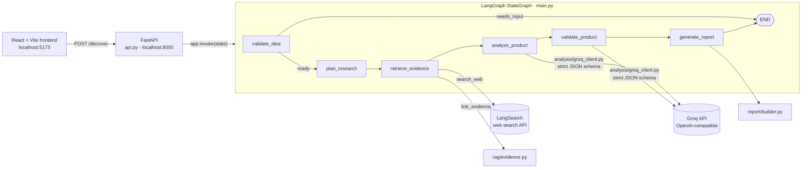

# Product Discovery & Validation Agent

**From a one-line product idea to a structured discovery report: problems, users, competitors, assumptions, an MVP scope and the experiments to test them, with links to the web pages the findings were drawn from.**


Most product ideas fail because nobody checked the problem, the users or the competition before building. This project automates the first pass of that homework. You describe an idea. A LangGraph workflow searches the web with LangSearch, asks a Groq-hosted model to analyse the results under a strict JSON schema, and turns that analysis into an MVP plan and validation experiments. The report says what to test next. It does not say the idea is good.

## Table of Contents

- [Overview](#overview)
- [The Problem](#the-problem)
- [Key Features](#key-features)
- [How It Works](#how-it-works)
- [Evidence Traceability](#evidence-traceability)
- [Architecture](#architecture)
- [Technology Stack](#technology-stack)
- [Project Structure](#project-structure)
- [Prerequisites](#prerequisites)
- [Installation and Setup](#installation-and-setup)
- [Environment Variables](#environment-variables)
- [Running the Application](#running-the-application)
- [Using the API](#using-the-api)
- [Example Workflow](#example-workflow)
- [Testing](#testing)
- [Limitations and Known Issues](#limitations-and-known-issues)
- [Security and Privacy](#security-and-privacy)
- [Roadmap](#roadmap)
- [Contributing](#contributing)
- [License](#license)
- [Author](#author)

## Overview

The Product Discovery & Validation Agent is a full-stack application:

- A **Python backend** that runs a six-node [LangGraph](https://github.com/langchain-ai/langgraph) workflow and exposes it through **FastAPI**.
- A **React + Vite frontend** where you enter an idea and read the report.

It is aimed at students, founders and product managers who want an evidence-oriented starting point before talking to users or writing code.

## The Problem

Early product decisions are usually made on intuition. Discovery work (understanding the problem, who has it, what already exists and which assumptions are still unproven) is slow, so it gets skipped.

LLMs can speed this up, but a model asked "is this a good idea?" will happily invent market data. This project constrains the model instead:

- The analysis step sees **only** search results collected in the same run.
- System prompts tell the model not to claim interviews happened and not to treat online discussion as proof of demand.
- Every model response must match a **strict Pydantic schema** (`extra="forbid"`), and findings must cite evidence indexes that were actually sent to the model.
- Assumptions are kept separate from findings and are never presented as sourced facts.

## Key Features

| Feature | Where | Notes |
| --- | --- | --- |
| Input validation and conditional routing | `main.py` | An empty idea ends the graph with `status: "needs_input"`. |
| Bounded research plan | `main.py` | Five research questions per idea. |
| Web search with a fixed budget | `rag/web_search.py`, `main.py` | LangSearch, at most **5 searches × 5 results** per run. |
| Evidence filtering and provenance | `rag/evidence.py` | Drops results without a title, URL or snippet; tags the rest with the research question and retrieval time. |
| Size-limited, schema-constrained analysis | `analysis/analyzer.py`, `analysis/schema.py` | At most 10 excerpts reach the model; Groq structured output with strict JSON Schema. |
| Source-linked findings | `report/builder.py`, `report/schema.py` | Each evidence-backed finding lists the web pages it cites. |
| MVP and validation planning | `analysis/validator.py`, `analysis/validation_schema.py` | Assumptions, MVP features, and experiments with a success signal and priority. |
| Typed final report | `report/builder.py`, `report/schema.py` | Assembled from earlier stages without an extra LLM call. |
| Clear provider errors | `analysis/groq_client.py`, `rag/web_search.py`, `api.py` | Groq and LangSearch limits, outages and incomplete output return HTTP 503 with a safe message. |
| REST API | `api.py` | `GET /health`, `POST /discover`, generated docs at `/docs`. |
| Web frontend | `frontend/` | Idea input, report with contents and sources, print to PDF, How It Works and documentation pages, light and dark themes. |
| Offline test suite | `test_*.py`, `conftest.py` | Runs with no network access; live and model tests are opt-in. |

## How It Works

```text
Product idea
  -> validate_idea       reject empty input
  -> plan_research       5 research questions
  -> retrieve_evidence   up to 5 LangSearch queries; keep items with title, URL and snippet
  -> analyze_product     Groq: findings and opportunities that cite evidence indexes
  -> validate_product    Groq: assumptions, MVP features and experiments
  -> generate_report     ProductReport with sources and cited findings
```

1. **Validate idea.** Strips whitespace. An empty idea routes straight to the end.
2. **Plan research.** Creates five questions: the problem, who has it, existing alternatives, supporting evidence and unverified assumptions. Only the first question contains your idea text.
3. **Retrieve evidence.** Searches each question for up to five results until the budget of five searches is used. Results are normalised to `title`, `url`, `snippet`, `source` and `domain`. Each record keeps the research question it came from.
4. **Analyse.** Selects up to 10 evidence items, spread across the research questions, and trims each excerpt. Sends them to Groq and receives problem, user and competitor findings, plus opportunities. Each finding lists `evidence_indexes`, which must be indexes of items that were sent.
5. **Validate.** Sends the analysis and idea to Groq again and receives assumptions, MVP features and validation experiments.
6. **Report.** Builds a `ProductReport`. Findings are flattened to the same string lists as before, and the report also gets a de-duplicated `sources` list and `cited_findings`.

## Evidence Traceability

This section describes exactly what the report can and cannot show.

**How a citation flows through the system**

```text
LangSearch result
  -> normalize_results      keeps title, url, snippet, domain
  -> link_evidence          keeps items with title, url and snippet (no fact-checking)
  -> state["evidence"]      the list every index refers to
  -> select_evidence        picks up to 10 items; each keeps its original "index"
  -> Groq analysis          may cite only those "index" values
  -> parse_analysis         rejects any index that was not sent, and any finding with no index
  -> build_report           turns indexes into de-duplicated source ids (1, 2, ...)
  -> API response           report.sources and report.cited_findings
  -> frontend               [n] markers link to a Sources list of http(s) URLs
```

**What is guaranteed**

- Every citation in `cited_findings` points to a source in `sources`.
- Every evidence-backed finding cites at least one evidence item that was sent to the model. Findings with no valid index are rejected, not shown without a source.
- Indexes always refer to the original linked evidence list, even after evidence is selected for the model.
- A web page that supports several findings appears once in `sources`.
- The API keeps every field it returned before. `sources` and `cited_findings` were added alongside them.

**What is not guaranteed**

- **Citations show what the model was given, not what is true.** The system checks that a cited index exists. It does not check that the cited excerpt supports the statement. Nothing in this codebase fact-checks a claim.
- **"source_linked" in the code means citable.** `evidence_status: "source_linked"` is set when a result has a title, URL and snippet. The `claim` field is a copy of the snippet, not an extracted or checked claim.
- **Only evidence sent to the model can be cited.** Up to 10 of the up to 25 search results reach the model. The rest stay in the workflow state but are never cited.
- **Assumptions, MVP features and validation experiments are never sourced.** They are listed in their own sections and labelled as unverified assumptions or recommendations in the frontend.
- **The report's Assumptions section comes from the validation stage.** The assumptions produced by the analysis stage are not copied into the report.
- **Web search does not prove demand.** A search result that discusses a problem is not evidence that customers will pay for a solution.

## Architecture



All workflow state flows through one `AgentState` `TypedDict`: `product_idea`, `status`, `message`, `research_questions`, `evidence`, `search_count`, `analysis`, `validation` and `report`. Each node returns only the keys it changes.

> **Note:** `rag/embeddings.py`, `rag/ingestion.py` and `rag/vector_store.py` (Sentence Transformers, PDF ingestion and a local Chroma store) are from an earlier RAG prototype. They have tests but are **not called by the workflow or the API**.

## Technology Stack

| Technology | Role in this project |
| --- | --- |
| **Python 3.10+** | Backend runtime. Tested on 3.11.9. The main dependencies checked (FastAPI, LangGraph, OpenAI SDK, requests) require 3.10 or newer. |
| **LangGraph** | Defines the workflow as a typed state graph with a conditional edge after input validation. |
| **FastAPI and Uvicorn** | Serves the workflow over HTTP, validates the request body, generates OpenAPI docs, and allows CORS from the Vite dev server. |
| **Pydantic v2** | Defines the schemas for analysis, validation and report. The JSON Schema generated from each model is sent to Groq. |
| **OpenAI Python SDK, pointed at Groq** | Calls Groq's OpenAI-compatible endpoint (`https://api.groq.com/openai/v1`) with structured outputs. Default model: `openai/gpt-oss-20b`. |
| **LangSearch web search API** | Live web search, called with `requests`. Returns pages with a name, URL and text. |
| **python-dotenv** | Loads keys and settings from a local `.env` file. |
| **React 19 and Vite 8** | Single-page frontend with hash-based routing. It uses no router or UI library. |
| **pytest and FastAPI TestClient** | Offline unit, workflow and API tests, with external calls mocked. |
| *Sentence Transformers, ChromaDB, pypdf* | Sentence Transformers and ChromaDB are used only by the RAG prototype and its model tests. pypdf is needed by the ingestion test. |

## Project Structure

```text
.
├── api.py                      # FastAPI app: /health and /discover
├── main.py                     # LangGraph workflow (AgentState + 6 nodes)
├── conftest.py                 # Skips live/model tests by default; blocks network in offline runs
├── pytest.ini                  # Registers the "live" and "model" markers
├── requirements.txt            # Backend and offline-test dependencies (pinned)
├── requirements-model.txt      # Optional: sentence-transformers and chromadb for model tests
├── .env.example                # Placeholder configuration; copy to .env
├── analysis/
│   ├── groq_client.py          # Shared Groq call: token budget, 413/429/5xx handling
│   ├── analyzer.py             # Evidence selection and analysis (Groq)
│   ├── schema.py               # DiscoveryAnalysis, Finding (with index checks)
│   ├── validator.py            # Analysis -> ProductValidation (Groq)
│   └── validation_schema.py    # ProductValidation, ValidationExperiment
├── rag/
│   ├── web_search.py           # LangSearch request + result normalisation
│   ├── evidence.py             # Evidence filtering and provenance fields
│   ├── embeddings.py           # (prototype, not in workflow) Sentence Transformers
│   ├── ingestion.py            # (prototype, not in workflow) PDF text + chunking
│   └── vector_store.py         # (prototype, not in workflow) Chroma store
├── report/
│   ├── builder.py              # Builds the report and resolves citations
│   └── schema.py               # ProductReport, ReportSource, CitedFindings
├── data/
│   └── sample.pdf              # Input for the ingestion test
├── test_*.py                   # Test suite (see Testing)
└── frontend/
    ├── package.json
    ├── vite.config.js
    └── src/
        ├── main.jsx
        ├── App.jsx             # Routing, navigation, theme, API call (API_URL)
        ├── index.css           # Design system (light and dark)
        └── pages/              # Home, Discover, Report, HowItWorks, Docs
```

## Prerequisites

| Requirement | Details |
| --- | --- |
| **Python 3.10 or newer** | Required by the dependencies. Development and tests used Python 3.11.9. |
| **Node.js** | Vite 8 requires Node `^20.19.0` or `>=22.12.0` (from its `engines` field). The project was developed on Node v24.19.0. `frontend/package.json` declares no `engines` field of its own. |
| **Groq API key** | Create one at [console.groq.com](https://console.groq.com). Used for analysis and validation. |
| **LangSearch API key** | Create one at [langsearch.com](https://langsearch.com). Used for web search. |
| **Windows PowerShell** | The commands below are for PowerShell. The code itself is not Windows-specific. |

Both API providers have usage limits. A single discovery run can make up to five search requests and two Groq requests.

## Installation and Setup

Run these commands from the project root in PowerShell.

```powershell
# 1. Clone the repository
git clone https://github.com/Sourabhnamdev9981/product-discovery-validation-agent.git
cd product-discovery-validation-agent

# 2. Create and activate a virtual environment
python -m venv .venv
.\.venv\Scripts\Activate.ps1

# 3. Install backend dependencies (runtime and offline tests)
python -m pip install -r requirements.txt

# 4. Optional: model-test dependencies (large download)
# python -m pip install -r requirements-model.txt

# 5. Install frontend dependencies
cd frontend
npm install
cd ..

# 6. Create your configuration file and add your keys
Copy-Item .env.example .env
notepad .env
```

If PowerShell blocks `Activate.ps1`, allow local scripts for your user once:

```powershell
Set-ExecutionPolicy -Scope CurrentUser -ExecutionPolicy RemoteSigned
```

## Environment Variables

Settings are read from a `.env` file in the project root (loaded with `python-dotenv`) or from the environment. Real environment variables take precedence over `.env`. `.env` is git-ignored. Commit only `.env.example`.

| Variable | Required | Default in code | Used by | Purpose and valid values |
| --- | --- | --- | --- | --- |
| `GROQ_API_KEY` | **Yes** | none | `analysis/groq_client.py` | Authenticates the analysis and validation calls. Read when a request is made. |
| `LANGSEARCH_API_KEY` | **Yes** | none | `rag/web_search.py` | Authenticates web search. Read when the module loads. |
| `GROQ_MODEL` | No | `openai/gpt-oss-20b` | `analysis/groq_client.py` | Groq model ID. The model must support JSON-schema structured outputs. |
| `GROQ_MAX_COMPLETION_TOKENS` | No | `2048` | `analysis/groq_client.py` | Output cap per Groq request, including reasoning tokens. A response cut off at this cap is reported as an error. |
| `GROQ_REASONING_EFFORT` | No | `low` | `analysis/groq_client.py` | `low`, `medium` or `high` for gpt-oss models. Set to an empty value to omit the parameter. |
| `ANALYSIS_MAX_EVIDENCE_ITEMS` | No | `10` | `analysis/analyzer.py` | Maximum evidence items sent to the analysis model. |
| `ANALYSIS_MAX_EXCERPT_CHARS` | No | `500` | `analysis/analyzer.py` | Maximum characters per evidence excerpt. Longer excerpts are cut at a word boundary. |
| `ANALYSIS_MAX_EVIDENCE_CHARS` | No | `9000` | `analysis/analyzer.py` | Maximum total characters of evidence JSON in one analysis request. |

Notes:

- The search URL, the Groq base URL and the search size limits are fixed in code. They are not configurable.
- The `GROQ_*` and `ANALYSIS_*` settings are read when the module is imported, so restart the backend after changing them.
- Missing keys do not stop the server from starting. The error appears when a discovery reaches the search or analysis step. The `RUN_LIVE_TESTS` and `RUN_MODEL_TESTS` flags are for tests only and are described under [Testing](#testing).
- The frontend API address is fixed to `http://localhost:8000` (`API_URL` in `frontend/src/App.jsx`).

The current Groq limits and their effect are described in [Limitations](#limitations-and-known-issues).

## Running the Application

Use two PowerShell windows, both opened in the project root.

**Window 1: backend**

```powershell
.\.venv\Scripts\Activate.ps1
python -m uvicorn api:api --reload
```

The API listens on `http://localhost:8000`. `api:api` means the `api` object inside `api.py`.

**Window 2: frontend**

```powershell
cd frontend
npm run dev
```

Open `http://localhost:5173`. The backend allows CORS only from that origin (`api.py`). If Vite picks a different port, free port 5173 or update `allow_origins` in `api.py`.

**Command-line run (no frontend)**

```powershell
python main.py
```

This runs the workflow on a built-in example idea and prints the research questions, evidence and report. It makes real LangSearch and Groq requests.

## Using the API

Interactive documentation is generated by FastAPI at **`http://localhost:8000/docs`** while the backend is running.

### `GET /health`

```json
{ "status": "ok" }
```

### `POST /discover`

Runs the whole workflow in one request. The request stays open until the report is ready, which can take a while because it makes several external calls.

**Request**

```json
{
  "product_idea": "An AI tool that helps students prepare for job interviews"
}
```

**Response, `200 OK`**

```json
{
  "status": "ready",
  "message": "Final product discovery report generated.",
  "report": {
    "product_idea": "An AI tool that helps students prepare for job interviews",
    "key_problems": ["..."],
    "target_users": ["..."],
    "competitor_findings": ["..."],
    "assumptions": ["..."],
    "opportunities": ["..."],
    "mvp_features": ["..."],
    "validation_experiments": ["..."],
    "sources": [
      { "id": 1, "title": "...", "url": "https://...", "domain": "..." }
    ],
    "cited_findings": {
      "key_problems": [{ "statement": "...", "source_ids": [1] }],
      "target_users": [{ "statement": "...", "source_ids": [1, 2] }],
      "competitor_findings": [{ "statement": "...", "source_ids": [2] }],
      "opportunities": [{ "statement": "...", "source_ids": [1] }]
    }
  }
}
```

The first eight report fields are the original contract and keep their meaning. `sources` and `cited_findings` are additional. `source_ids` refer to the `id` values in `sources`. An empty `source_ids` list means no source is linked to that finding.

**Responses for other cases**

| Case | HTTP status | Body |
| --- | --- | --- |
| Blank `product_idea` | `200` | `status: "needs_input"`, `message: "Please provide a product idea."`, `report: {}` |
| Missing `product_idea` field | `422` | FastAPI validation error |
| Groq rejects the request for size, or the rate limit is reached | `503` | `{"detail": "..."}`. For a rate limit, the message includes the retry time when Groq provides it. |
| Groq is unavailable, cannot be reached, or returns empty or cut-off output | `503` | `{"detail": "..."}` |
| Groq returns analysis or validation JSON that does not match the schema | `503` | `{"detail": "..."}` |
| LangSearch rate-limits, fails, cannot be reached, or returns an unreadable response | `503` | `{"detail": "..."}` |
| Missing API key, or any other unexpected error | `500` | Generic server error. The message is not returned. |

Requests are not retried. A `413` (request too large) is not retried because the same request cannot succeed.

PowerShell example:

```powershell
Invoke-RestMethod -Method Post -Uri http://localhost:8000/discover `
  -ContentType "application/json" `
  -Body '{"product_idea": "An AI tool that helps students prepare for job interviews"}'
```

### LangSearch response format

If search fails, check that `rag/web_search.py` receives this shape. The application reads `data.webPages.value` and expects `code` to be `"200"`:

```json
{
  "code": "200",
  "data": {
    "webPages": {
      "value": [
        {
          "name": "Page title",
          "url": "https://example.com/page",
          "text": "Page excerpt. Falls back to 'snippet' if 'text' is missing.",
          "siteName": "Example",
          "displayUrl": "example.com"
        }
      ]
    }
  }
}
```

Items without a name, URL or text are skipped.

## Example Workflow

> This walkthrough shows **what the system does and the shape of its output**. It is not a recorded result. The content depends on live search results and the model.

**Input:** *"An AI tool that helps students prepare for job interviews"*

1. The plan has five questions. The first includes your idea. The others cover affected users, alternatives, supporting evidence and open assumptions.
2. Up to five searches return up to 25 results. Results without a name, URL or text are dropped. The rest are tagged with their question.
3. Up to ten of those excerpts are sent to the analysis model. It returns findings such as a problem statement that cites excerpts 0 and 3, and opportunities that cite other excerpts.
4. The validation stage proposes assumptions, MVP features and experiments. Each experiment has an assumption, a success signal and a priority.
5. The report is returned with seven sections. Each finding in the first four evidence-based sections shows `[n]` markers that scroll to the Sources list.

| Section | Source of the text | Linked to web sources? |
| --- | --- | --- |
| Key Problems | `analysis.problem_findings` | Yes |
| Target Users | `analysis.user_findings` | Yes |
| Competitor Findings | `analysis.competitor_findings` | Yes |
| Opportunities | `analysis.opportunities` (inference from sources) | Yes, labelled as inference |
| Assumptions | `validation.assumptions` | No, unverified |
| MVP Features | `validation.mvp_features` | No, recommendation |
| Validation Experiments | `validation.validation_experiments[].experiment` | No, recommendation |

## Testing

The default test run is offline. It makes no LangSearch, Groq or Hugging Face requests and needs no keys.

**Default, offline:**

```powershell
python -m pytest
```

Three safeguards keep this run offline:

1. Tests marked `live` are skipped unless `RUN_LIVE_TESTS=1` is set.
2. Tests marked `model` are skipped unless `RUN_MODEL_TESTS=1` is set.
3. In these default runs, `conftest.py` refuses any outbound TCP connection except to loopback addresses. An accidental real request fails with a clear error instead of spending quota.

The result is printed at the end of the run, showing passed tests and skipped tests with their reasons.

**Live API tests (uses quota and needs keys in `.env`):**

```powershell
$env:RUN_LIVE_TESTS = "1"
python -m pytest -m live -v
Remove-Item Env:RUN_LIVE_TESTS
```

| Test | Calls |
| --- | --- |
| `test_groq_analysis.py::test_groq_analysis` | One Groq analysis request |
| `test_web_search_live.py::test_product_discovery_search` | One LangSearch request |
| `test_langsearch_manual.py::test_langsearch_manual_print` | One LangSearch request; prints results with `-s` |

Each live test skips with a message if its key is not set in `.env`. The skip message names the variable but does not show its value.

**Model tests (downloads a model and writes a local store):**

```powershell
python -m pip install -r requirements-model.txt
$env:RUN_MODEL_TESTS = "1"
python -m pytest -m model -v
Remove-Item Env:RUN_MODEL_TESTS
```

| Test | Effect |
| --- | --- |
| `test_embeddings.py` | Downloads `all-MiniLM-L6-v2` on the first run |
| `test_vector_store.py` | Writes to `data/chroma/` (git-ignored). Chunk IDs are fixed, so a second run against an existing store can fail with a duplicate-ID error. Delete `data/chroma/` to reset it. |

**Frontend checks:**

```powershell
cd frontend
npm run lint
npm run build
cd ..
```

**Mocked and unit tests** cover the parts of the workflow that matter most: the full graph with search, analysis and validation replaced by fixtures; the API with the workflow replaced by a mock; evidence filtering; schema rules for findings and evidence indexes; evidence selection and its index mapping; report citations; and Groq error handling.

## Limitations and Known Issues

**Search results**

- **Quality and freshness depend on LangSearch.** Results are whatever the search API returns for each query. Relevance and recency are not checked.
- **Research questions are partly generic.** Only the first of the five questions contains the product idea. The other four are fixed templates, so those searches are not tailored to the idea.
- **Search region and freshness are fixed in code.** `count` is limited to 1 to 50, and `freshness` is set to `noLimit`.

**Evidence**

- **"Source linked" means citable, not fact-checked.** Pages are not opened and claims are not compared across sources.
- **Only 10 excerpts reach the model** by default, each cut to 500 characters. Other results are not cited.
- **Citations are checked for existence, not meaning.** A finding can cite a real source that does not actually support it.

**Model output**

- **Findings can be wrong.** The model can misread excerpts or write statements not supported by them. The strict schema checks structure, not truth.
- **Reasoning effort is low by default.** This reduces output length and cost, but can lower quality.

**Groq limits**

- **Token limits are per minute.** With the default settings, one analysis request is estimated at about 6,000 tokens in the worst case (input plus the 2,048-token output cap). That estimate is based on characters, not a tokenizer. Analysis and validation run one after another, so together they can still exceed the per-minute limit. A rate-limit error is then returned as HTTP 503 with a suggested wait time when Groq provides one. Requests are not retried.
- **Size checks are character estimates.** No tokenizer is used, so the request size is estimated from character counts.
- **Quotas are shared.** Every discovery uses up to five LangSearch requests and two Groq requests.

**Report and API**

- **The API is synchronous.** `POST /discover` blocks until the whole workflow finishes. There is no streaming, progress reporting, background job, caching or saved history.
- **Missing keys return a generic 500.** Provider failures return 503 with a message. Other unexpected errors return a generic 500 and do not show their message.
- **The report keeps no evidence excerpts.** Only titles, URLs and domains are returned.
- **Analysis-stage assumptions are not in the report.** The Assumptions section comes from the validation stage.

**Project setup**

- **Development-only configuration.** CORS allows only `http://localhost:5173`. The frontend API address is hard-coded. The API has no authentication or rate limiting.
- **Unused RAG code.** The embedding, ingestion and vector-store modules are not part of the workflow.
- **Test naming.** `test_langsearch_manual.py` is a live test, not a unit test. It duplicates `test_web_search_live.py` and could be removed.
- **Live and model behaviour has not been proven in this document.** The offline suite is tested. Live calls and the frontend in a browser are not covered by automated tests.

## Security and Privacy

- **API keys stay on the server.** `GROQ_API_KEY` and `LANGSEARCH_API_KEY` are read from the environment or `.env`. They are not returned by the API, sent to the frontend, or printed by the tests.
- **Keep `.env` private.** It is listed in `.gitignore`. Only `.env.example`, which holds placeholders, belongs in version control.
- **Your idea leaves your machine.** The idea text is sent to LangSearch inside search queries, and the excerpts plus idea are sent to Groq. Read their data policies before you submit anything confidential.
- **Nothing is stored.** The backend does not save ideas, search results or reports. The frontend keeps the latest report in memory only, so reloading the page clears it. The one exception is the optional model test, which writes to `data/chroma/`.
- **The API has no authentication.** Run it on your own machine. Do not expose it to a network as it is.

## Roadmap

These are suggestions, not implemented features.

- [ ] Generate idea-specific research questions instead of fixed templates.
- [ ] Verify citations semantically: open each source, check that the excerpt supports the finding, and record the result.
- [ ] Return excerpts and success signals in the report, alongside the source list.
- [ ] Include the analysis stage's own assumptions in the report, or remove them from the analysis output.
- [ ] Stream progress for each workflow node instead of one blocking request.
- [ ] Make the frontend API address configurable with a Vite environment variable.
- [ ] Make the Chroma test idempotent, or remove it if the RAG prototype is dropped.
- [ ] Remove the duplicate manual LangSearch test and add CI that runs the offline suite.

## Contributing

1. Fork the repository and create a branch: `git checkout -b feature/your-change`.
2. Keep changes focused. Add or update offline tests for new behaviour.
3. Run `python -m pytest` and the frontend `npm run lint` and `npm run build` (see [Testing](#testing)).
4. Open a pull request that describes what changed and why.

Never commit `.env` or API keys.

## License

No license file has been added to this repository yet. Until one is added, all rights are reserved by the author.

## Author

**Sourabh Namdev**, [GitHub](https://github.com/Sourabhnamdev9981)
